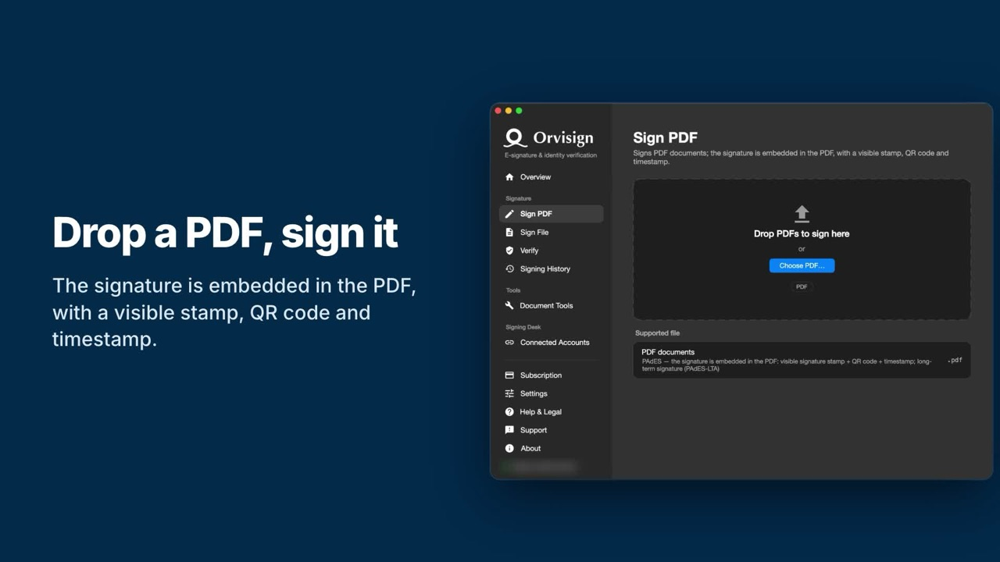
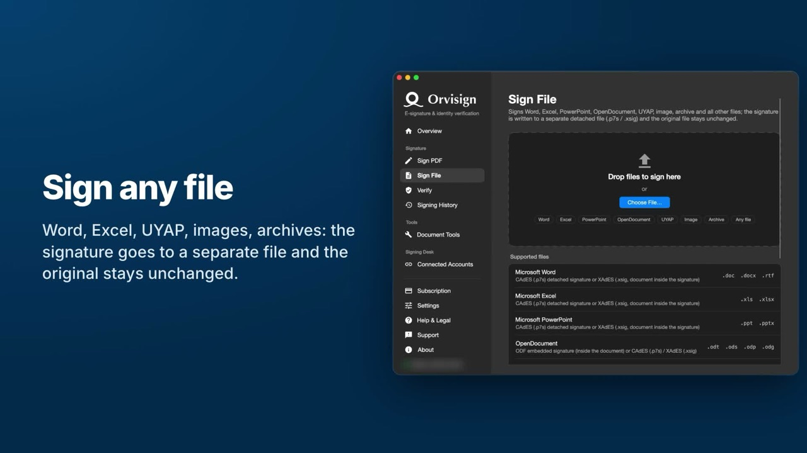
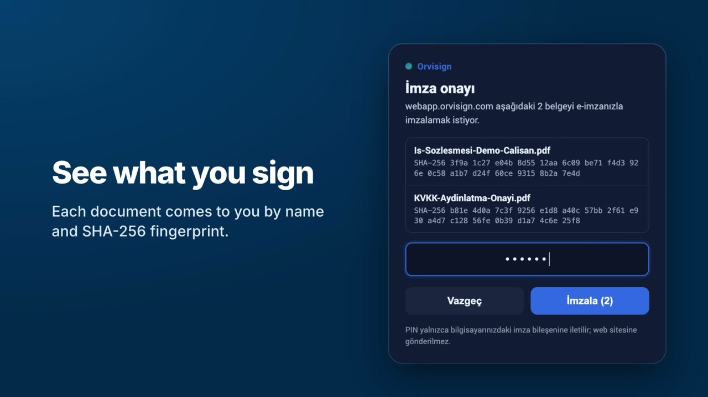
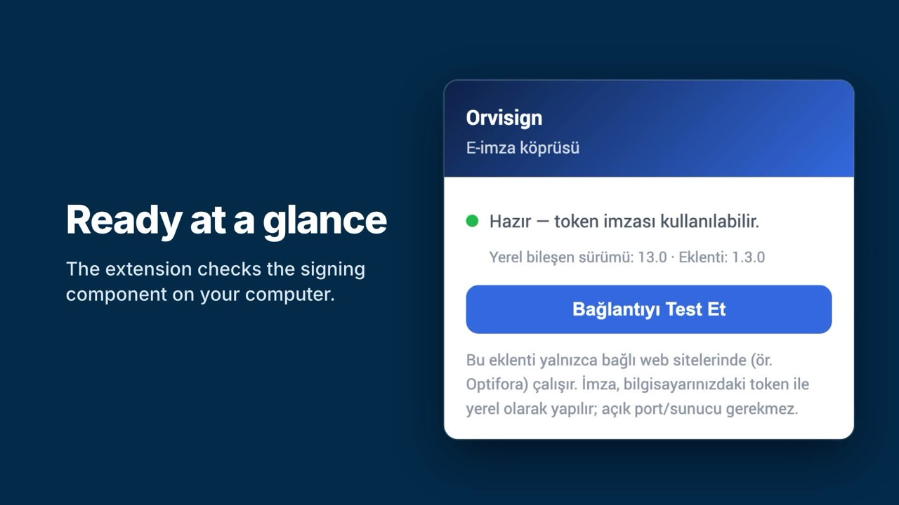
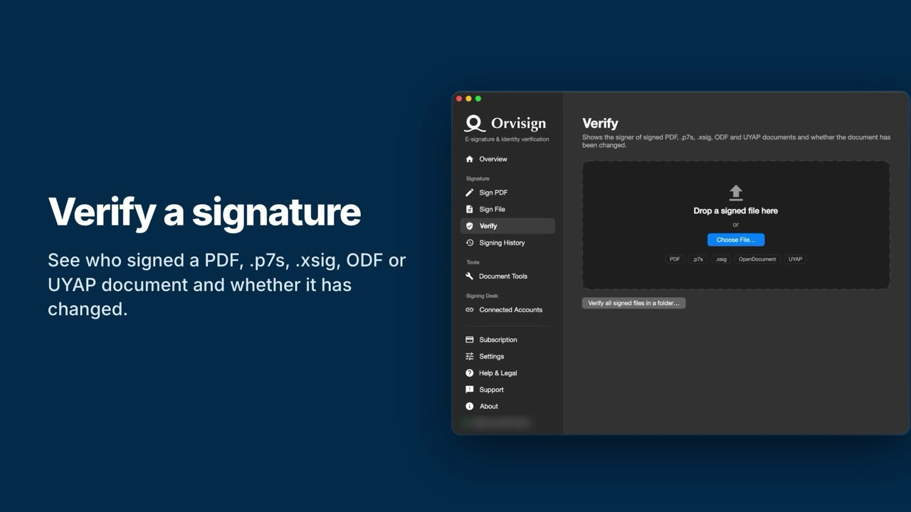
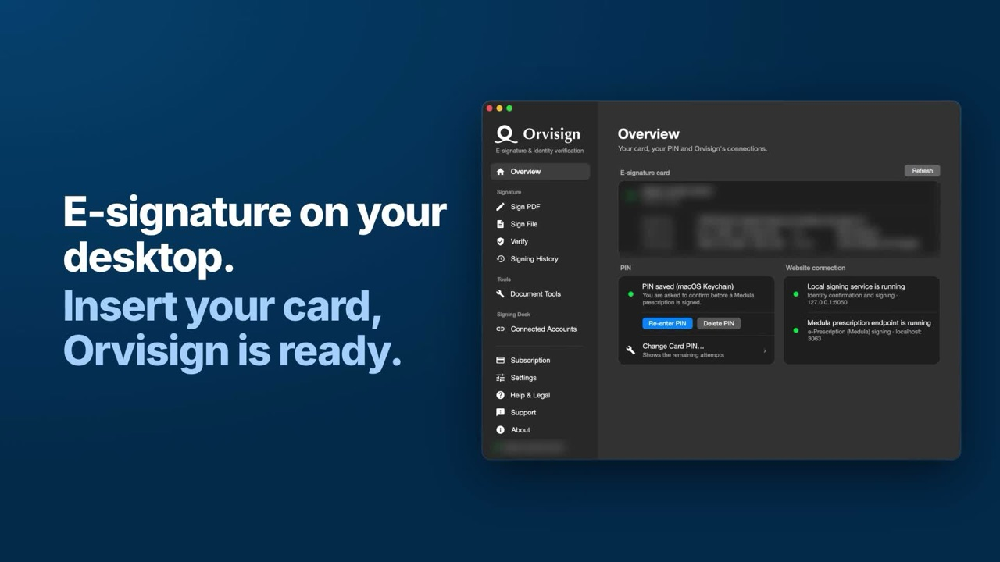

<p align="center">
  <a href="https://orvisign.com/en/index.html"></a>
</p>

<h1 align="center">Orvisign — e-signature for PDF, XML and any file</h1>

<p align="center">
  Sign with your qualified e-signature card or Turkcell Mobile Signature · answer signing and identity requests from websites · collect signatures from others · verify signed documents.
</p>

<p align="center">
  <a href="https://github.com/egerobot/orvisign-releases/releases/latest"></a>
  
  
  <a href="https://orvisign.com/en/subscription.html"></a>
</p>

<p align="center">
  <a href="https://orvisign.com/en/index.html"><b>orvisign.com</b></a> ·
  <a href="https://orvisign.com/en/apps.html">Downloads</a> ·
  <a href="https://orvisign.com/en/faq.html">FAQ</a> ·
  <a href="https://orvisign.com/en/support.html">Support</a> ·
  <a href="README.tr.md">Türkçe</a>
</p>

---

This repository is the **official download channel for Orvisign installers on GitHub**. It contains release files only — no source code. The primary download page is [orvisign.com](https://orvisign.com/en/apps.html); every file here is the same signed installer, listed with its SHA-256 checksum.

## Download

| Platform | What to download | Notes |
|---|---|---|
| **macOS** (Apple silicon and Intel) | [`Orvisign-13.0.5.pkg`](https://github.com/egerobot/orvisign-releases/releases/latest) | Developer ID signed and notarized by Apple |
| **macOS** — Browser Helper | [`Orvisign-Browser-Helper-13.0.5.pkg`](https://github.com/egerobot/orvisign-releases/releases/latest) | Lets the browser extension reach your e-signature card |
| **Windows 10 / 11** (x64 and ARM64) | Microsoft Store — listing is in certification | Until the Store listing opens, see [orvisign.com/en/apps.html](https://orvisign.com/en/apps.html). The `.msix` files in each release are archive copies; Windows installs them from the Store. |
| **Web** | [webapp.orvisign.com](https://webapp.orvisign.com/) | No installation |
| **Browser extension** (Chrome, Edge, Firefox, Opera) | From the browser stores — see [orvisign.com/en/apps.html](https://orvisign.com/en/apps.html) | The `.zip` files in each release are archive copies of the store packages |
| **iOS and Android** | Coming soon | Planned; development has not started yet |

## What Orvisign does

### 1. Sign your files — PDF, XML and any file



- **PDF — PAdES**: the signature is embedded in the PDF with a visible stamp, QR code and time stamp; long-term **PAdES-LTA** for archives.
- **Any file — CAdES**: Word, Excel, PowerPoint, OpenDocument, UYAP, images and archives get a detached `.p7s` signature; the original file stays unchanged.
- **XML — XAdES**.
- Works with qualified e-signature cards and USB tokens that have a **PKCS#11** driver, such as Kamu SM AKİS, SafeNet IDPrime and OpenSC-supported cards — RSA keys and the EC384 keys Kamu SM has issued since May 2025.
- **No card? Use Turkcell Mobile Signature** and approve each signature on your phone.



### 2. Identity and signing bridge for websites



Websites you use can ask Orvisign for a **signature, a Medula submission or an identity confirmation** through the browser extension or the desktop app:

1. You press sign or confirm on the website.
2. Orvisign opens **its own window** showing the requesting site, your card and your certificate — and each document by name and SHA-256 fingerprint — before any PIN is asked.
3. Your PIN goes **only to your card**; the private key never leaves the card. The website never sees your PIN.
4. A time stamp is added and the signed result returns to the website.

No open port on your computer, no firewall prompts. The extension checks the signing component and offers the download if a piece is missing.



### 3. Signing Desk — collect signatures from one or more people

Upload one or more documents, invite one or more signers and track every signature at [orvisign.com](https://orvisign.com/en/signing-desk.html). Signers sign **in order** with their own e-signature card or mobile signature; people without an account receive an e-mail invitation, open an account and sign. The desktop app shows your Signing Desk processes and their status.

### 4. Verify signatures and prepare documents



- **Verify** signed PDF, `.p7s`, XML, ODF and UDF documents: see who signed, with which certificate, when, and whether the document has changed since.
- **21 document tools** before you sign: merge, split, compress, add page numbers or a watermark, convert images to PDF and more.


### 5. For developers — add card signing and identity confirmation to your software

If your web application needs its users to **sign with an e-signature card** (PAdES, CAdES, XAdES) or **confirm their identity with their certificate**, Orvisign can do this for your users on their own computer: your site asks, the user approves in Orvisign's window, the card signs, and your site receives the signed result. Keys and PINs never reach your site or our servers.

Integration is enabled per website. To add your site and get the integration documentation, write to **info@orvisign.com**.

## Desktop app



Insert your card and Orvisign is ready: sign PDF, sign any file, verify, document tools, signing history, Signing Desk and connected accounts — in one app for **macOS and Windows**.

## Is it legally valid?

Yes, when it is made with a qualified electronic certificate. Under **Turkish Law No. 5070 on Electronic Signatures**, a secure electronic signature has the same legal effect as a handwritten signature. Orvisign uses your own qualified certificate; it does not issue certificates. [Read more](https://orvisign.com/en/answer/is-an-orvisign-signature-legally-valid).

## Plans

The **Free** plan includes card signing, verification, document tools and 3 mobile signatures a day. **Plus**, **Gold** and **Premium** add the Signing Desk and more mobile signatures a day. See [orvisign.com/en/subscription.html](https://orvisign.com/en/subscription.html).

## Verify your download

Every release has a `SHA256SUMS` file.

```bash
# macOS
shasum -a 256 Orvisign-13.0.5.pkg
pkgutil --check-signature Orvisign-13.0.5.pkg
spctl -a -vvv -t install Orvisign-13.0.5.pkg   # expect: accepted, source=Notarized Developer ID
```

```powershell
# Windows (PowerShell)
Get-FileHash .\Orvisign_13.0.5.0_x64.msix -Algorithm SHA256
```

The checksum must match the line in `SHA256SUMS`. The macOS installers are signed by **Developer ID Installer: EGEROBOT OTOMASYON MUHENDISLIK PROJE DANISMANLIK SANAYI VE TICARET LIMITED SIRKETI (9S8KV52JV4)** and notarized by Apple.

## Frequently asked questions

- [What is Orvisign?](https://orvisign.com/en/answer/what-is-orvisign)
- [How does Orvisign work?](https://orvisign.com/en/answer/how-does-orvisign-work)
- [Which e-signature cards does Orvisign support?](https://orvisign.com/en/answer/which-cards-does-orvisign-support)
- [Does Orvisign see my PIN or my document?](https://orvisign.com/en/answer/does-orvisign-see-my-pin)
- [Can I sign without an e-signature card?](https://orvisign.com/en/answer/can-i-sign-without-a-card)
- [Is Orvisign free?](https://orvisign.com/en/answer/is-orvisign-free)

## Support, security and legal

- Support: [orvisign.com/en/support.html](https://orvisign.com/en/support.html) · info@orvisign.com
- Security reports: see [SECURITY.md](SECURITY.md)
- [Privacy Policy](https://orvisign.com/en/legal/privacy.html) · [Terms of Service](https://orvisign.com/en/legal/terms.html) · [KVKK Notice](https://orvisign.com/en/legal/kvkk.html) · [All legal texts](https://orvisign.com/en/legal/index.html)

---

<sub>Orvisign is a product of **EGEROBOT** (EGEROBOT OTOMASYON MÜHENDİSLİK PROJE DANIŞMANLIK SAN. VE TİC. LTD. ŞTİ.), İzmir, Türkiye. Orvisign is proprietary software; see [LICENSE](LICENSE).<br>
Keywords: e-signature, electronic signature, digital signature, qualified electronic signature, e-imza, PDF signing, PAdES, CAdES, XAdES, .p7s, smart card, USB token, PKCS#11, Kamu SM AKİS, Turkcell Mobile Signature, mobil imza, Medula, UYAP, signature verification, document signing, macOS, Windows.</sub>
