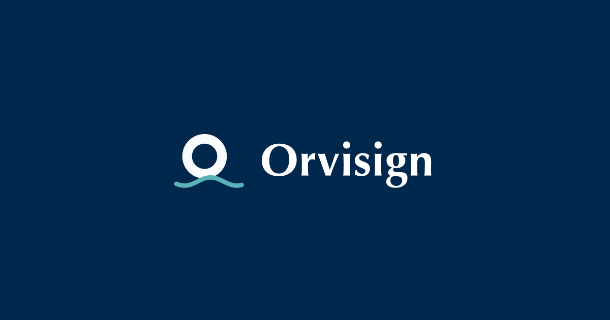
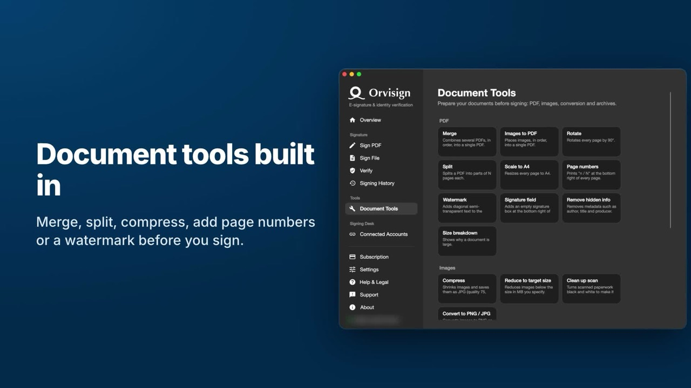

<p align="center">
  <a href="https://orvisign.com/en/index.html"></a>
</p>

<h1 align="center">Orvisign — e-signature software for PDF, XML and any file</h1>

<p align="center">
  Sign PDFs and files with your qualified e-signature card or USB token · confirm your identity on websites · collect signatures with Signing Desk · verify signed documents — on Mac, Windows and the web.
</p>

<p align="center">
  <a href="https://github.com/egerobot/orvisign-releases/releases/latest"></a>
  
  
  <a href="https://orvisign.com/en/subscription.html"></a>
</p>

<p align="center">
  <a href="https://orvisign.com/en/index.html"><b>orvisign.com</b></a> ·
  <a href="https://orvisign.com/en/apps.html">Downloads</a> ·
  <a href="https://orvisign.com/en/faq.html">FAQ</a> ·
  <a href="https://orvisign.com/en/support.html">Support</a> ·
  <a href="README.tr.md">Türkçe</a>
</p>

---

This repository is the **official download channel for Orvisign installers on GitHub**. It contains release files only — no source code. The primary download page is [orvisign.com](https://orvisign.com/en/apps.html); every file here is the same signed installer, listed with its SHA-256 checksum.

## Download — digital signature software for Mac and Windows

| Platform | What to download | Notes |
|---|---|---|
| **macOS 13 Ventura or later** (Apple silicon and Intel) | [`Orvisign-13.0.6.pkg`](https://github.com/egerobot/orvisign-releases/releases/latest) | Developer ID signed and notarized by Apple. Installs into your own Applications folder without asking for the Mac's password. |
| **macOS** — Browser Helper | [`Orvisign-Browser-Helper-13.0.6.pkg`](https://github.com/egerobot/orvisign-releases/releases/latest) | Lets the browser extension reach your e-signature card |
| **Windows 10 / 11** (x64 and ARM64) | [Orvisign on the Microsoft Store](https://apps.microsoft.com/detail/9p7pp83zg7dr) | Installs and updates from the Store. The `.msix` files in each release are archive copies; Windows installs Orvisign from the Store. |
| **Web** | [webapp.orvisign.com](https://webapp.orvisign.com/) | No installation |
| **Browser extension** | [Chrome Web Store](https://chromewebstore.google.com/detail/ddhncflbpobbihnofeclekmdepgleehj) · [Microsoft Edge Add-ons](https://microsoftedge.microsoft.com/addons/detail/dnbimnofkloaafdmmkkkjbmhmcidgokb) · [Firefox Add-ons](https://addons.mozilla.org/en-US/firefox/addon/orvisign/) | The `.zip` files in each release (Chrome, Edge, Firefox, Opera) are archive copies of the store packages |
| **iOS** (iPhone and iPad) | Coming soon to the App Store | In development; the iOS app brings Turkcell Mobile Signature |

## Sign a PDF with your smart card or USB token (PAdES)


- **PDF — PAdES**: the signature is embedded in the PDF with a visible stamp, QR code and time stamp; long-term **PAdES-LTA** keeps the signature verifiable after the certificate has expired.
- Place the stamp on the page preview, choose the page, or sign invisibly; add your drawn handwritten signature to the pages you choose.
- **Folder watch**: files dropped into an inbox folder are signed with your card and written to an output folder.

## Sign any file (CAdES `.p7s`) and XAdES


- **Any file — CAdES**: Word, Excel, PowerPoint, OpenDocument, UYAP, images and archives get a detached `.p7s` signature; the original file stays unchanged.
- **XAdES** (`.xsig`) and an embedded signature for OpenDocument files are also available.

## Supported e-signature cards and USB tokens (PKCS#11)

Orvisign works with qualified e-signature cards and USB tokens that have a **PKCS#11** driver, such as Kamu SM AKİS, SafeNet IDPrime and OpenSC-supported cards — RSA keys and the EC384 (ECDSA P-384) keys Kamu SM has issued since May 2025. It sees the card the moment you plug it in, names the driver to install if one is missing, warns you before your certificate expires, and lets you change the card PIN in its own window.

## Identity verification and signing bridge for websites


Websites you use can ask Orvisign for a **signature or an identity confirmation** through the browser extension or the desktop app:

1. You press sign or confirm on the website.
2. Orvisign opens **its own window** showing the requesting site, your card and your certificate — and each document by name and SHA-256 fingerprint — before any PIN is asked.
3. Your PIN goes **only to your card**; the private key never leaves the card. The website never sees your PIN.
4. For signatures, a time stamp is added and the signed result returns to the website.

Only sites on the allowed list get an answer. With the extension, the browser talks to the Orvisign Browser Helper over its own channel; the desktop app's local signing service accepts requests only from this computer. The extension checks the signing component and offers the download if a piece is missing. The extension is published for Chrome, Edge and Firefox; on the Mac, the Browser Helper registers for those and also for Opera, Brave, Vivaldi, Arc, Opera GX and Yandex.


## Signing Desk — collect signatures from several people

Put one or more documents — up to 20, each up to 50 MB — in an envelope and send it to the people who must sign at [orvisign.com](https://orvisign.com/en/signing-desk.html). They sign **one after another in the order you choose, or all at the same time**, with their qualified e-signature card; people without an account receive an e-mail invitation, open an account and sign. You follow each signer live and download the completed package. Every step is written to a chained log that cannot be altered afterwards. The desktop app shows your Signing Desk processes and their status.

## Verify a digital signature in a PDF or `.p7s` file


**Verify** signed PDF, `.p7s`, XAdES (`.xsig`), ODF and UDF documents: see who signed, with which certificate, when, and whether the document has changed since.

## 21 document tools



Prepare documents before you sign: merge, split, rotate and scale PDFs to A4, add page numbers, a watermark or an empty signature field, convert images to PDF, compress images, clean metadata, convert between PDF, ODT and UYAP (UDF), and create or extract archives.

## For developers — e-signature API

- **Browser interface, available now:** when the Orvisign extension is installed, your page gets `window.Orvisign` with `hello`, `devices`, `certificate`, `sign`, `signHash` and `verify`. Ask for a PAdES, CAdES or XAdES signature, sign only a hash and keep the document on your server, or send a one-time challenge to `signHash` to log users in with their card. Wrong PIN, locked PIN and no card come back as separate error codes.
- **Server-to-server signing API, early access:** open a signing envelope from your server with an API key; your users sign at orvisign.com with their card, and your server is notified and downloads the signed package.

Keys and PINs never reach your site or our servers. Integration is enabled per website. To add your site and get the integration documentation, write to **info@orvisign.com**. See [orvisign.com/en/developers.html](https://orvisign.com/en/developers.html).

## Is it legally valid? (qualified electronic signature)

Yes, when it is made with a qualified electronic certificate. Under **Turkish Law No. 5070 on Electronic Signatures**, a secure electronic signature has the same legal effect as a handwritten signature. Orvisign uses your own qualified certificate; it does not issue certificates. [Read more](https://orvisign.com/en/answer/is-an-orvisign-signature-legally-valid).

## Plans

Card signing, identity verification for websites, verification and document tools are free. **Plus**, **Gold** and **Premium** add sending with Signing Desk. See [orvisign.com/en/subscription.html](https://orvisign.com/en/subscription.html).

## Verify your download

Every release has a `SHA256SUMS` file.

```bash
# macOS
shasum -a 256 -c SHA256SUMS --ignore-missing
pkgutil --check-signature Orvisign-13.0.6.pkg   # expect: Notarization: trusted by the Apple notary service
spctl -a -vvv -t install Orvisign-13.0.6.pkg   # expect: accepted, source=Notarized Developer ID
```

```powershell
# Windows (PowerShell)
Get-FileHash .\Orvisign_13.0.6.0_x64.msix -Algorithm SHA256
```

The checksum must match the line in `SHA256SUMS`. The macOS installers are signed by **Developer ID Installer: EGEROBOT OTOMASYON MUHENDISLIK PROJE DANISMANLIK SANAYI VE TICARET LIMITED SIRKETI (9S8KV52JV4)** and notarized by Apple.

## Frequently asked questions

**How do I digitally sign a PDF with a smart card?**
Install Orvisign and your card's PKCS#11 driver, insert the card, open **Sign PDF** and drop the PDF. Enter your PIN in Orvisign's own window; the PDF is signed with PAdES, a visible stamp, a QR code and a time stamp.

**How do I sign a PDF with my smart card on a Mac?**
Install `Orvisign-13.0.6.pkg` (macOS 13 or later, Apple silicon and Intel) and your card brand's macOS driver, then sign as above. The installer needs no administrator password.

**How do I use a USB token for a digital signature?**
A USB token with a PKCS#11 driver works exactly like a card: plug it in, and Orvisign shows it on the Overview screen.

**What is the difference between PAdES, CAdES and XAdES?**
PAdES embeds the signature inside the PDF. CAdES writes a separate `.p7s` signature next to any file and leaves the file unchanged. XAdES is an XML-based signature (`.xsig`).

**How do I verify a digital signature in a PDF or open a `.p7s` file?**
Open **Verify** in the desktop app or the web app and add the file. Orvisign shows who signed, with which certificate, when, and whether the document has changed since.

**Is a qualified electronic signature legally valid?**
Under Turkish Law No. 5070, a secure electronic signature made with a qualified certificate has the same legal effect as a handwritten signature.

**Is there a digital signature extension for Chrome or Firefox?**
Yes — Orvisign is on the Chrome Web Store, Microsoft Edge Add-ons and Firefox Add-ons. On a Mac, install the Orvisign Browser Helper too. The desktop app can also answer allowed sites without an extension.

**Is Orvisign free?**
Card signing, identity verification, verification and document tools are free. Sending with Signing Desk is part of the Plus, Gold and Premium plans.

More answers: [What is Orvisign?](https://orvisign.com/en/answer/what-is-orvisign) · [How does Orvisign work?](https://orvisign.com/en/answer/how-does-orvisign-work) · [Which cards does Orvisign support?](https://orvisign.com/en/answer/which-cards-does-orvisign-support) · [Does Orvisign see my PIN or my document?](https://orvisign.com/en/answer/does-orvisign-see-my-pin) · [Can I sign without an e-signature card?](https://orvisign.com/en/answer/can-i-sign-without-a-card) · [Is Orvisign free?](https://orvisign.com/en/answer/is-orvisign-free)

## Support, security and legal

- Support: [orvisign.com/en/support.html](https://orvisign.com/en/support.html) · info@orvisign.com
- Security reports: see [SECURITY.md](SECURITY.md)
- [Privacy Policy](https://orvisign.com/en/legal/privacy.html) · [Terms of Service](https://orvisign.com/en/legal/terms.html) · [KVKK Notice](https://orvisign.com/en/legal/kvkk.html) · [All legal texts](https://orvisign.com/en/legal/index.html)

---

<sub>Orvisign is a product of **EGEROBOT** (EGEROBOT OTOMASYON MÜHENDİSLİK PROJE DANIŞMANLIK SAN. VE TİC. LTD. ŞTİ.), İzmir, Türkiye. Orvisign is proprietary software; see [LICENSE](LICENSE).</sub>
