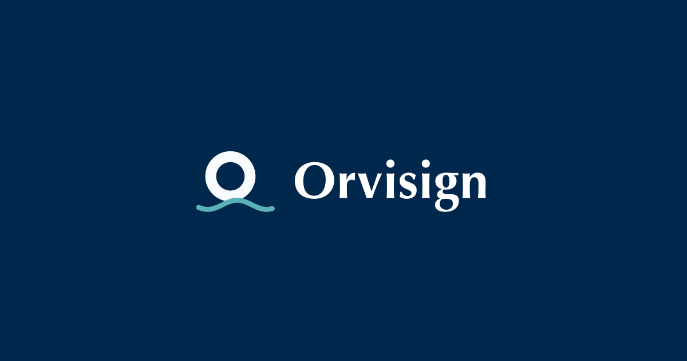
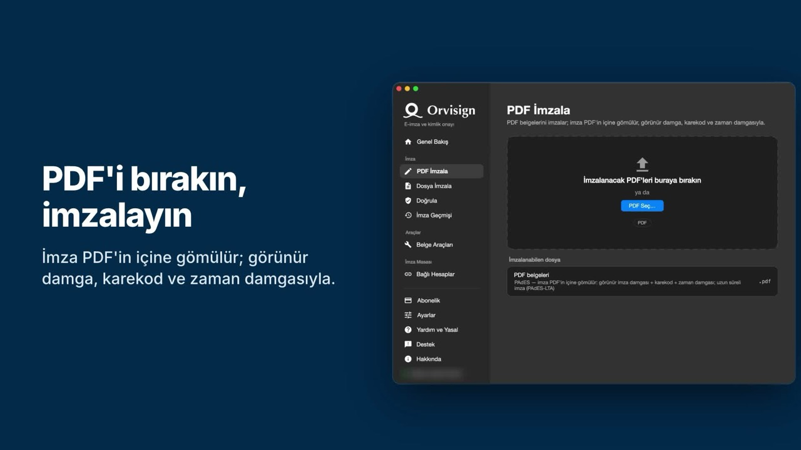
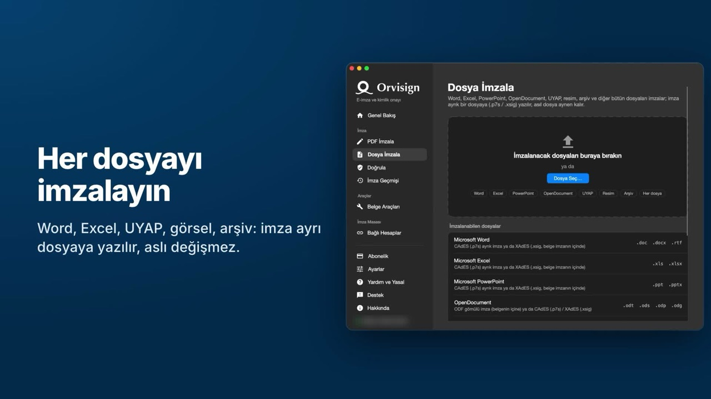
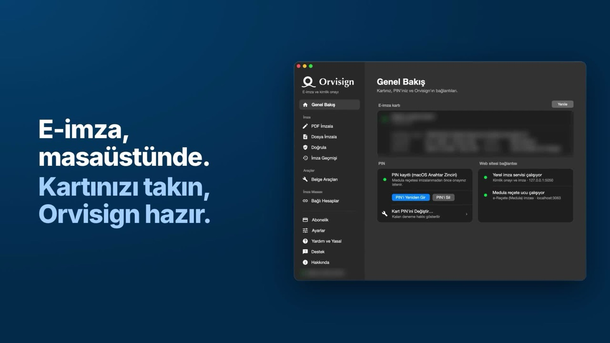
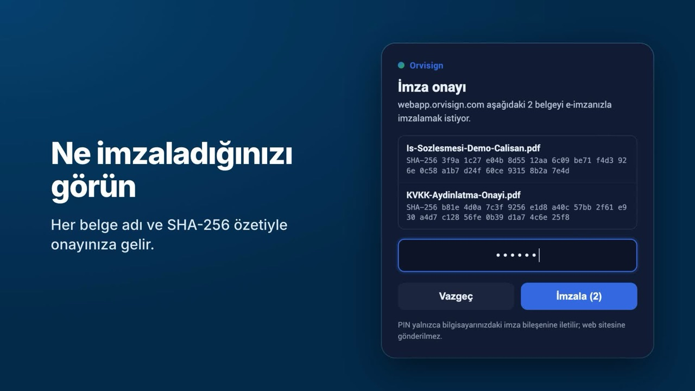
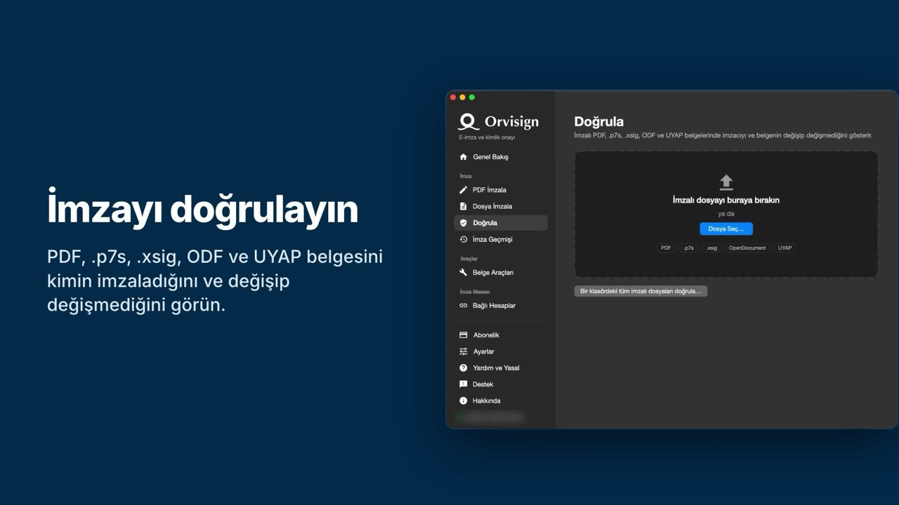

<p align="center">
  <a href="https://orvisign.com/tr/index.html"></a>
</p>

<h1 align="center">Orvisign — PDF, XML ve her dosya için e-imza programı</h1>

<p align="center">
  Nitelikli e-imza kartınızla ya da USB token'ınızla PDF ve dosya imzalayın · sitelerde e-imza ile kimlik doğrulayın · İmza Masası ile başkalarına imzalatın · imzalı belgeleri doğrulayın — Mac, Windows ve web'de.
</p>

<p align="center">
  <a href="https://github.com/egerobot/orvisign-releases/releases/latest"></a>
  
  
  <a href="https://orvisign.com/tr/subscription.html"></a>
</p>

<p align="center">
  <a href="https://orvisign.com/tr/index.html"><b>orvisign.com</b></a> ·
  <a href="https://orvisign.com/tr/apps.html">İndir</a> ·
  <a href="https://orvisign.com/tr/faq.html">SSS</a> ·
  <a href="https://orvisign.com/tr/support.html">Destek</a> ·
  <a href="README.md">English</a>
</p>

---

Bu depo, **Orvisign kurulum dosyalarının GitHub'daki resmî indirme kanalıdır**. İçinde yalnız sürüm dosyaları vardır, kaynak kod yoktur. Asıl indirme sayfası [orvisign.com](https://orvisign.com/tr/apps.html)'dur; buradaki her dosya oradakiyle aynı imzalı kurulum dosyasıdır ve SHA-256 özetiyle birlikte verilir.

## E-imza programı indir — Mac ve Windows

| Platform | İndirilecek dosya | Not |
|---|---|---|
| **macOS 13 Ventura ve sonrası** (Apple çipli ve Intel) | [`Orvisign-13.0.6.pkg`](https://github.com/egerobot/orvisign-releases/releases/latest) | Developer ID ile imzalı, Apple onaylı (notarize). Kendi Uygulamalar klasörünüze kurulur; Mac'in parolasını sormaz. |
| **macOS** — Tarayıcı Yardımcısı | [`Orvisign-Browser-Helper-13.0.6.pkg`](https://github.com/egerobot/orvisign-releases/releases/latest) | Tarayıcı eklentisinin e-imza kartınıza ulaşmasını sağlar |
| **Windows 10 / 11** (x64 ve ARM64) | [Microsoft Store'da Orvisign](https://apps.microsoft.com/detail/9p7pp83zg7dr?hl=tr-TR&gl=TR) | Store'dan kurulur ve güncellenir. Sürümlerdeki `.msix` dosyaları arşiv kopyasıdır; Windows kurulumu Store'dan yapılır. |
| **Web** | [webapp.orvisign.com](https://webapp.orvisign.com/) | Kurulum gerekmez |
| **Tarayıcı eklentisi** | [Chrome Web Mağazası](https://chromewebstore.google.com/detail/ddhncflbpobbihnofeclekmdepgleehj) · [Microsoft Edge Eklentileri](https://microsoftedge.microsoft.com/addons/detail/dnbimnofkloaafdmmkkkjbmhmcidgokb) · [Firefox Eklentileri](https://addons.mozilla.org/tr/firefox/addon/orvisign/) | Sürümlerdeki `.zip` dosyaları (Chrome, Edge, Firefox, Opera) mağaza paketlerinin arşiv kopyasıdır |
| **iOS** (iPhone ve iPad) | Yakında App Store'da | Geliştirme sürüyor; Turkcell Mobil İmza iOS uygulamasıyla gelecek |

## E-imza ile PDF imzalama (PAdES)



- **PDF — PAdES**: imza PDF'nin içine gömülür; görünür damga, karekod ve zaman damgasıyla. Uzun süreli **PAdES-LTA** ile imza, sertifikanın süresi dolduktan sonra da doğrulanabilir.
- Damgayı sayfa önizlemesinde yerleştirin, sayfasını seçin ya da görünmez imza atın; çizdiğiniz el imzasını seçtiğiniz sayfalara ekleyin.
- **Klasör izleme**: gelen kutusu klasörüne bırakılan dosyalar kartınızla imzalanır ve çıktı klasörüne yazılır.

## Her dosyayı imzalayın: CAdES (`.p7s`) ve XAdES



- **Her dosya — CAdES**: Word, Excel, PowerPoint, OpenDocument, UYAP, görsel ve arşiv dosyalarına ayrı `.p7s` imzası yazılır; asıl dosya değişmez.
- **XAdES** (`.xsig`) ve OpenDocument dosyaları için belgeye gömülü imza da seçilebilir.

## Desteklenen kartlar: AKİS ve PKCS#11 token'lar

Orvisign, **PKCS#11** sürücüsü olan nitelikli e-imza kartları ve USB token'larla çalışır: Kamu SM AKİS kart, SafeNet IDPrime ve OpenSC'nin desteklediği kartlar — RSA anahtarlar ve Kamu SM'nin Mayıs 2025'ten beri verdiği EC384 (ECDSA P-384) anahtarlar. Kartı takar takmaz görür, sürücü eksikse hangisinin kurulacağını söyler, sertifikanızın süresi dolmadan uyarır ve kart PIN'ini kendi penceresinde değiştirmenizi sağlar.

## Mac'te e-imza



Orvisign, macOS 13 ve sonrasında Apple çipli ve Intel Mac'lerde çalışan, yalnız macOS'un kendi bileşenleriyle yazılmış yerel bir Mac uygulamasıdır; kart sürücüsü dışında başka bir şey kurmanız gerekmez. `.pkg` dosyasını açın, kart markanızın macOS sürücüsünü kurun, kartı takın. Kurulum yönetici parolası istemez.

## Siteler için e-imza ile kimlik doğrulama ve imza köprüsü



Kullandığınız siteler tarayıcı eklentisi ya da masaüstü uygulaması üzerinden Orvisign'dan **imza, Medula gönderimi ya da kimlik doğrulaması** isteyebilir:

1. Sitede imzala ya da doğrula düğmesine basarsınız.
2. Orvisign, PIN sormadan önce **kendi penceresinde** isteyen siteyi, kartınızı ve sertifikanızı — her belgeyi de adı ve SHA-256 özetiyle — gösterir.
3. PIN'iniz **yalnız kartınıza** gider; özel anahtar karttan hiç çıkmaz. Site PIN'inizi görmez.
4. İmzada zaman damgası eklenir ve imzalı sonuç siteye döner.

Yalnız izinli listedeki siteler cevap alır. Eklentiyle tarayıcı, Orvisign Tarayıcı Yardımcısı ile kendi kanalından konuşur; masaüstü uygulamasının yerel imza hizmeti yalnız bu bilgisayardan gelen istekleri kabul eder. Eklenti imza bileşenini denetler; eksik parça varsa indirme bağlantısını gösterir. E-imza tarayıcı eklentisi Chrome, Edge ve Firefox için yayımlanmıştır; Mac'te Tarayıcı Yardımcısı bunlara ek olarak Opera, Brave, Vivaldi, Arc, Opera GX ve Yandex'e de kaydolur.


## İmza Masası — birden çok kişiye imzalatın

Bir ya da birden çok belgeyi — en çok 20 belge, her biri en çok 50 MB — bir zarfa koyun ve imzalaması gereken kişilere [orvisign.com](https://orvisign.com/tr/signing-desk.html) üzerinden gönderin. İmzacılar nitelikli e-imza kartlarıyla, **seçtiğiniz sırayla ya da aynı anda** imzalar; hesabı olmayan kişiye e-postayla davet gider, hesap açar ve imzalar. Her imzacıyı canlı izler, tamamlanan paketi indirirsiniz. Her adım sonradan değiştirilemeyen zincirli bir kayda yazılır. Masaüstü uygulaması İmza Masası süreçlerinizi ve durumlarını gösterir.

## E-imza doğrulama



İmzalı PDF, `.p7s`, XAdES (`.xsig`), ODF ve UDF belgelerini **doğrulayın**: kimin, hangi sertifikayla, ne zaman imzaladığını ve belgenin sonradan değişip değişmediğini görün.

## 21 belge aracı


İmzadan önce belgenizi hazırlayın: PDF birleştirin, bölün, döndürün, A4'e ölçekleyin; sayfa numarası, filigran ya da boş imza alanı ekleyin; görselleri PDF'ye çevirin, sıkıştırın; üst verileri temizleyin; PDF, ODT ve UYAP (UDF) arasında dönüştürün; arşiv oluşturun ya da açın.

## Geliştiriciler için — e-imza API'si

- **Tarayıcı arayüzü, bugün kullanılabilir:** Orvisign eklentisi kuruluysa sayfanız `hello`, `devices`, `certificate`, `sign`, `signHash` ve `verify` içeren `window.Orvisign` nesnesini alır. PAdES, CAdES ya da XAdES imza isteyin, yalnız özeti imzalatıp belgeyi kendi sunucunuzda tutun ya da kullanıcıyı kartıyla giriş yaptırmak için `signHash`'e tek kullanımlık bir soru gönderin. Yanlış PIN, kilitli PIN ve kart yok ayrı hata kodlarıyla döner.
- **Sunucudan sunucuya imza API'si, erken erişim:** API anahtarıyla sunucunuzdan imza zarfı açın; kullanıcılarınız orvisign.com'da kartlarıyla imzalar, sunucunuza bildirim gider ve imzalı paketi indirir.

Anahtar ve PIN ne sitenize ne de sunucularımıza ulaşır. Entegrasyon site bazında açılır. Sitenizi eklemek ve entegrasyon belgelerini almak için **info@orvisign.com** adresine yazın. Bkz. [orvisign.com/tr/developers.html](https://orvisign.com/tr/developers.html).

## Hukuken geçerli mi? (nitelikli elektronik imza)

Nitelikli elektronik sertifikayla atıldığında evet. **5070 sayılı Elektronik İmza Kanunu**'na göre güvenli elektronik imza, elle atılan imzayla aynı hukuki sonucu doğurur. Orvisign sizin nitelikli sertifikanızı kullanır; sertifika vermez. [Ayrıntı](https://orvisign.com/tr/answer/is-an-orvisign-signature-legally-valid).

## Planlar

Kartla imza, siteler için kimlik doğrulama, doğrulama ve belge araçları ücretsizdir. **Plus**, **Gold** ve **Premium**, İmza Masası ile gönderimi ekler. Bkz. [orvisign.com/tr/subscription.html](https://orvisign.com/tr/subscription.html).

## İndirdiğiniz dosyayı doğrulayın

Her sürümde bir `SHA256SUMS` dosyası vardır.

```bash
# macOS
shasum -a 256 -c SHA256SUMS --ignore-missing
pkgutil --check-signature Orvisign-13.0.6.pkg   # beklenen: Notarization: trusted by the Apple notary service
spctl -a -vvv -t install Orvisign-13.0.6.pkg   # beklenen: accepted, source=Notarized Developer ID
```

```powershell
# Windows (PowerShell)
Get-FileHash .\Orvisign_13.0.6.0_x64.msix -Algorithm SHA256
```

Özet, `SHA256SUMS` içindeki satırla aynı olmalıdır. macOS kurulum dosyaları **Developer ID Installer: EGEROBOT OTOMASYON MUHENDISLIK PROJE DANISMANLIK SANAYI VE TICARET LIMITED SIRKETI (9S8KV52JV4)** ile imzalı ve Apple onaylıdır.

## Sık sorulan sorular

**E-imza nasıl atılır?**
Orvisign'ı ve kartınızın PKCS#11 sürücüsünü kurun, kartı takın, **PDF İmzala** ya da **Dosya İmzala** ekranını açıp dosyayı bırakın, **İmzala**'ya basın ve PIN'inizi Orvisign'ın kendi penceresine girin.

**E-imza ile PDF nasıl imzalanır?**
**PDF İmzala** ekranında PDF'yi bırakın, damganın yerini ve sayfasını seçin, PIN'inizi girin. PDF; PAdES imzası, görünür damga, karekod ve zaman damgasıyla kaydedilir.

**Mac'te e-imza nasıl kullanılır?**
`Orvisign-13.0.6.pkg` dosyasını kurun (macOS 13 ve sonrası, Apple çipli ve Intel), kart markanızın macOS sürücüsünü yükleyin ve kartı takın. Kurulum yönetici parolası istemez.

**E-imza ile mobil imza arasındaki fark nedir?**
E-imzada nitelikli sertifika akıllı kartta ya da USB token'da durur ve imza kart okuyucuyla atılır. Mobil imzada sertifika telefon hattınızdaki SIM karttadır ve imza telefondan onaylanır. Orvisign bugün kart ve token ile imzalar; Turkcell Mobil İmza iOS uygulamasıyla gelecek.

**E-imza doğrulama nasıl yapılır, belgeyi kimin imzaladığını nasıl görürüm?**
Masaüstü uygulamasında ya da web uygulamasında **Doğrula** ekranını açıp dosyayı ekleyin. Orvisign kimin, hangi sertifikayla, ne zaman imzaladığını ve belgenin sonradan değişip değişmediğini gösterir.

**E-imza ile kimlik doğrulama nasıl yapılır?**
Site, yalnız o giriş ya da işlem için geçerli bir soru gönderir. Orvisign kendi penceresinde hangi sitenin istediğini ve hangi sertifikanın cevap vereceğini gösterir; PIN'i oraya girersiniz. Kartınız soruyu imzalar, site imzayı ve sertifikanızı denetler.

**"Akıllı karta erişilemiyor" ya da kart görünmüyorsa ne yapmalıyım?**
Orvisign'daki **Sağlık kontrolü** (Ayarlar › Bakım ve tanı) okuyucuyu, kart türünü, sürücüyü, PIN durumunu ve yerel imza hizmetini tek seferde denetler. Sürücü kurulu değilse Orvisign kart türünü tanır ve hangi sürücünün nereden kurulacağını gösterir.

**.p7s dosyası nasıl açılır?**
`.p7s` dosyası asıl belgenin yanında duran ayrı imzadır; asıl belge değişmez ve her zamanki programla açılır. İmzayı görmek için `.p7s` dosyasını Orvisign'ın **Doğrula** ekranına ekleyin.

**E-imza tarayıcı eklentisi var mı?**
Evet — Chrome Web Mağazası, Microsoft Edge Eklentileri ve Firefox Eklentileri'nde. Mac'te Orvisign Tarayıcı Yardımcısı'nı da kurun. Masaüstü uygulaması, izinli sitelere eklenti olmadan da cevap verebilir.

**Orvisign ücretsiz mi?**
Kartla imza, kimlik doğrulama, doğrulama ve belge araçları ücretsizdir. İmza Masası ile gönderim Plus, Gold ve Premium planlarındadır.

Daha fazla cevap: [Orvisign nedir?](https://orvisign.com/tr/answer/what-is-orvisign) · [Orvisign nasıl çalışır?](https://orvisign.com/tr/answer/how-does-orvisign-work) · [Orvisign hangi e-imza kartlarını destekler?](https://orvisign.com/tr/answer/which-cards-does-orvisign-support) · [Orvisign PIN'imi ya da belgemi görür mü?](https://orvisign.com/tr/answer/does-orvisign-see-my-pin) · [E-imza kartı olmadan imzalayabilir miyim?](https://orvisign.com/tr/answer/can-i-sign-without-a-card) · [Orvisign ücretsiz mi?](https://orvisign.com/tr/answer/is-orvisign-free)

## Destek, güvenlik ve yasal

- Destek: [orvisign.com/tr/support.html](https://orvisign.com/tr/support.html) · info@orvisign.com
- Güvenlik bildirimi: [SECURITY.md](SECURITY.md)
- [Gizlilik Politikası](https://orvisign.com/tr/legal/privacy.html) · [Kullanım Koşulları](https://orvisign.com/tr/legal/terms.html) · [KVKK Aydınlatma Metni](https://orvisign.com/tr/legal/kvkk.html) · [Tüm yasal metinler](https://orvisign.com/tr/legal/index.html)

---

<sub>Orvisign, **EGEROBOT**'un (EGEROBOT OTOMASYON MÜHENDİSLİK PROJE DANIŞMANLIK SAN. VE TİC. LTD. ŞTİ.) ürünüdür, İzmir, Türkiye. Orvisign tescilli yazılımdır; bkz. [LICENSE](LICENSE).</sub>
