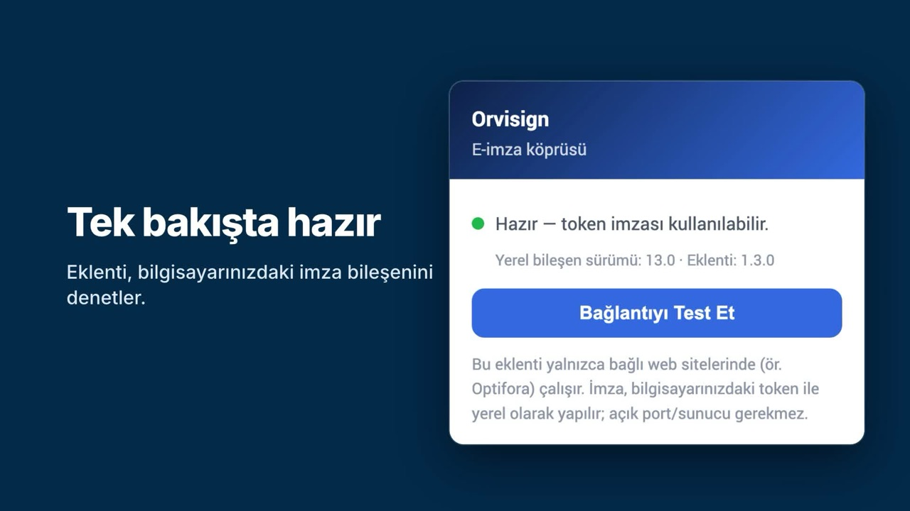
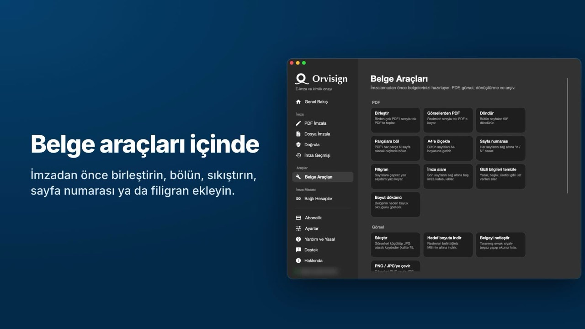

<p align="center">
  <a href="https://orvisign.com/tr/index.html"></a>
</p>

<h1 align="center">Orvisign — PDF, XML ve her dosya için e-imza</h1>

<p align="center">
  Nitelikli e-imza kartınızla ya da Turkcell Mobil İmza ile imzalayın · sitelerden gelen imza ve kimlik doğrulama isteklerini yanıtlayın · başkalarına imzalatın · imzalı belgeleri doğrulayın.
</p>

<p align="center">
  <a href="https://github.com/egerobot/orvisign-releases/releases/latest"></a>
  
  
  <a href="https://orvisign.com/tr/subscription.html"></a>
</p>

<p align="center">
  <a href="https://orvisign.com/tr/index.html"><b>orvisign.com</b></a> ·
  <a href="https://orvisign.com/tr/apps.html">İndir</a> ·
  <a href="https://orvisign.com/tr/faq.html">SSS</a> ·
  <a href="https://orvisign.com/tr/support.html">Destek</a> ·
  <a href="README.md">English</a>
</p>

---

Bu depo, **Orvisign kurulum dosyalarının GitHub'daki resmî indirme kanalıdır**. İçinde yalnız sürüm dosyaları vardır, kaynak kod yoktur. Asıl indirme sayfası [orvisign.com](https://orvisign.com/tr/apps.html)'dur; buradaki her dosya oradakiyle aynı imzalı kurulum dosyasıdır ve SHA-256 özetiyle birlikte verilir.

## İndir

| Platform | İndirilecek dosya | Not |
|---|---|---|
| **macOS** (Apple çipli ve Intel) | [`Orvisign-13.0.6.pkg`](https://github.com/egerobot/orvisign-releases/releases/latest) | Developer ID ile imzalı, Apple onaylı (notarize) |
| **macOS** — Tarayıcı Yardımcısı | [`Orvisign-Browser-Helper-13.0.6.pkg`](https://github.com/egerobot/orvisign-releases/releases/latest) | Tarayıcı eklentisinin e-imza kartınıza ulaşmasını sağlar |
| **Windows 10 / 11** (x64 ve ARM64) | [Microsoft Store'da Orvisign](https://apps.microsoft.com/detail/9p7pp83zg7dr?hl=tr-TR&gl=TR) | Store'dan kurulur ve güncellenir. Sürümlerdeki `.msix` dosyaları arşiv kopyasıdır; Windows kurulumu Store'dan yapılır. |
| **Web** | [webapp.orvisign.com](https://webapp.orvisign.com/) | Kurulum gerekmez |
| **Tarayıcı eklentisi** (Chrome, Edge, Firefox, Opera) | Tarayıcı mağazalarından — [orvisign.com/tr/apps.html](https://orvisign.com/tr/apps.html) | Sürümlerdeki `.zip` dosyaları mağaza paketlerinin arşiv kopyasıdır |
| **iOS ve Android** | Yakında | Planlandı; geliştirmesine henüz başlanmadı |

## Orvisign neler yapar

### 1. Dosyalarınızı imzalayın — PDF, XML ve her dosya


- **PDF — PAdES**: imza PDF'in içine gömülür; görünür damga, karekod ve zaman damgasıyla. Arşiv için uzun süreli **PAdES-LTA**.
- **Her dosya — CAdES**: Word, Excel, PowerPoint, OpenDocument, UYAP, görsel ve arşiv dosyalarına ayrı `.p7s` imzası yazılır; asıl dosya değişmez.
- **XML — XAdES**.
- **PKCS#11** sürücüsü olan nitelikli e-imza kartları ve USB token'larla çalışır: Kamu SM AKİS, SafeNet IDPrime ve OpenSC'nin desteklediği kartlar — RSA anahtarlar ve Kamu SM'nin Mayıs 2025'ten beri verdiği EC384 anahtarlar.
- **Kartınız yok mu? Turkcell Mobil İmza** ile her imzayı telefonunuzdan onaylayın.


### 2. Siteler için kimlik doğrulama ve imza köprüsü


Kullandığınız siteler tarayıcı eklentisi ya da masaüstü uygulaması üzerinden Orvisign'dan **imza, Medula gönderimi ya da kimlik doğrulaması** isteyebilir:

1. Sitede imzala ya da doğrula düğmesine basarsınız.
2. Orvisign, PIN sormadan önce **kendi penceresinde** isteyen siteyi, kartınızı ve sertifikanızı — her belgeyi de adı ve SHA-256 özetiyle — gösterir.
3. PIN'iniz **yalnız kartınıza** gider; özel anahtar karttan hiç çıkmaz. Site PIN'inizi görmez.
4. Zaman damgası eklenir ve imzalı sonuç siteye döner.

Bilgisayarınızda açık port yok, güvenlik duvarı uyarısı yok. Eklenti imza bileşenini denetler; eksik parça varsa indirme bağlantısını gösterir.



### 3. İmza Masası — bir ya da birden çok kişiye imzalatın

Bir ya da birden çok belgeyi yükleyin, bir ya da birden çok imzacıyı davet edin ve her imzayı [orvisign.com](https://orvisign.com/tr/signing-desk.html) üzerinden izleyin. İmzacılar **sırayla**, kendi e-imza kartları ya da mobil imzalarıyla imzalar; hesabı olmayan kişiye e-postayla davet gider, hesap açar ve imzalar. Masaüstü uygulaması İmza Masası süreçlerinizi ve durumlarını gösterir.

### 4. İmzayı doğrulayın, belgeyi hazırlayın


- İmzalı PDF, `.p7s`, XML, ODF ve UDF belgelerini **doğrulayın**: kimin, hangi sertifikayla, ne zaman imzaladığını ve belgenin sonradan değişip değişmediğini görün.
- İmzadan önce **21 belge aracı**: birleştirin, bölün, sıkıştırın, sayfa numarası ya da filigran ekleyin, görselleri PDF'e çevirin ve daha fazlası.



### 5. Geliştiriciler için — yazılımınıza kartla imza ve kimlik doğrulama ekleyin

Web uygulamanızda kullanıcılarınızın **e-imza kartıyla imzalaması** (PAdES, CAdES, XAdES) ya da **sertifikasıyla kimliğini doğrulaması** gerekiyorsa, Orvisign bunu kullanıcınızın kendi bilgisayarında yapar: siteniz ister, kullanıcı Orvisign penceresinde onaylar, kart imzalar ve siteniz imzalı sonucu alır. Anahtar ve PIN ne sitenize ne de sunucularımıza ulaşır.

Entegrasyon site bazında açılır. Sitenizi eklemek ve entegrasyon belgelerini almak için **info@orvisign.com** adresine yazın.

## Masaüstü uygulaması


Kartınızı takın, Orvisign hazır: PDF imzala, dosya imzala, doğrula, belge araçları, imza geçmişi, İmza Masası ve bağlı hesaplar — **macOS ve Windows** için tek uygulamada.

## Hukuken geçerli mi?

Nitelikli elektronik sertifikayla atıldığında evet. **5070 sayılı Elektronik İmza Kanunu**'na göre güvenli elektronik imza, elle atılan imzayla aynı hukuki sonucu doğurur. Orvisign sizin nitelikli sertifikanızı kullanır; sertifika vermez. [Ayrıntı](https://orvisign.com/tr/answer/is-an-orvisign-signature-legally-valid).

## Planlar

**Ücretsiz** plan kartla imza, doğrulama, belge araçları ve günde 3 mobil imza içerir. **Plus**, **Gold** ve **Premium** İmza Masası'nı ve günde daha fazla mobil imzayı ekler. Bkz. [orvisign.com/tr/subscription.html](https://orvisign.com/tr/subscription.html).

## İndirdiğiniz dosyayı doğrulayın

Her sürümde bir `SHA256SUMS` dosyası vardır.

```bash
# macOS
shasum -a 256 Orvisign-13.0.6.pkg
pkgutil --check-signature Orvisign-13.0.6.pkg
spctl -a -vvv -t install Orvisign-13.0.6.pkg   # beklenen: accepted, source=Notarized Developer ID
```

```powershell
# Windows (PowerShell)
Get-FileHash .\Orvisign_13.0.6.0_x64.msix -Algorithm SHA256
```

Özet, `SHA256SUMS` içindeki satırla aynı olmalıdır. macOS kurulum dosyaları **Developer ID Installer: EGEROBOT OTOMASYON MUHENDISLIK PROJE DANISMANLIK SANAYI VE TICARET LIMITED SIRKETI (9S8KV52JV4)** ile imzalı ve Apple onaylıdır.

## Sık sorulan sorular

- [Orvisign nedir?](https://orvisign.com/tr/answer/what-is-orvisign)
- [Orvisign nasıl çalışır?](https://orvisign.com/tr/answer/how-does-orvisign-work)
- [Orvisign hangi e-imza kartlarını destekler?](https://orvisign.com/tr/answer/which-cards-does-orvisign-support)
- [Orvisign PIN'imi ya da belgemi görür mü?](https://orvisign.com/tr/answer/does-orvisign-see-my-pin)
- [E-imza kartı olmadan imzalayabilir miyim?](https://orvisign.com/tr/answer/can-i-sign-without-a-card)
- [Orvisign ücretsiz mi?](https://orvisign.com/tr/answer/is-orvisign-free)

## Destek, güvenlik ve yasal

- Destek: [orvisign.com/tr/support.html](https://orvisign.com/tr/support.html) · info@orvisign.com
- Güvenlik bildirimi: [SECURITY.md](SECURITY.md)
- [Gizlilik Politikası](https://orvisign.com/tr/legal/privacy.html) · [Kullanım Koşulları](https://orvisign.com/tr/legal/terms.html) · [KVKK Aydınlatma Metni](https://orvisign.com/tr/legal/kvkk.html) · [Tüm yasal metinler](https://orvisign.com/tr/legal/index.html)

---

<sub>Orvisign, **EGEROBOT**'un (EGEROBOT OTOMASYON MÜHENDİSLİK PROJE DANIŞMANLIK SAN. VE TİC. LTD. ŞTİ.) ürünüdür, İzmir, Türkiye. Orvisign tescilli yazılımdır; bkz. [LICENSE](LICENSE).<br>
Anahtar kelimeler: e-imza, elektronik imza, nitelikli elektronik imza, güvenli elektronik imza, dijital imza, PDF imzalama, PAdES, CAdES, XAdES, .p7s, akıllı kart, e-imza token, PKCS#11, Kamu SM AKİS, Turkcell Mobil İmza, mobil imza, Medula e-imza, UYAP imza, imza doğrulama, belge imzalama, macOS, Windows.</sub>
